# Pixel Difference Convolution

This repository contains the PyTorch implementation for 
"Pixel Difference Networks for Efficient Edge Detection" 
by 
[Zhuo Su](https://zhuogege1943.com/homepage/)\*, 
[Wenzhe Liu]()\*, 
[Zitong Yu](https://www.oulu.fi/university/researcher/zitong-yu),
[Dewen Hu](https://dblp.org/pers/h/Hu:Dewen.html), 
[Qing Liao](http://liaoqing.me/),
[Qi Tian](https://scholar.google.com/citations?user=61b6eYkAAAAJ&hl=en),
[Matti Pietikäinen](https://en.wikipedia.org/wiki/Matti_Pietik%C3%A4inen_(academic)) and 
[Li Liu](http://lilyliliu.com/)\*\* 
(\* Authors have equal contributions, \*\* Corresponding author). \[[arXiv](https://arxiv.org/abs/2108.07009), [youtube](https://www.youtube.com/watch?v=jEAh_4wm1UU)\]

Please find the associated PidiNet Paper on link [our paper](pdc.bib). 

```
@ARTICLE{pdc-PAMI2023,
  author={Su, Zhuo and Zhang, Jiehua and Wang, Longguang and Zhang, Hua and Liu, Zhen and Pietikäinen, Matti and Liu, Li},
  journal={IEEE Transactions on Pattern Analysis and Machine Intelligence}, 
  title={Lightweight Pixel Difference Networks for Efficient Visual Representation Learning}, 
  year={2023},
  volume={45},
  number={12},
  pages={14956-14974},
  keywords={Image edge detection;Feature extraction;Computational modeling;Biological system modeling;Task analysis;Quantization (signal);Object recognition;Binary neural networks;convolutional neural networks;edge detection;efficient representation learning;facial recognition;image classification},
  doi={10.1109/TPAMI.2023.3300513}
}
```

This repository reproduces the paper on a laptop GPU. It lets you do three things:

| | What | Needs a dataset? | Section |
|---|---|---|---|
| 1 | Run the paper's **pretrained** models on your own images | No | [Part 1](#part-1--run-the-pretrained-models) |
| 2 | **Train** the Baseline and the complete PiDiNet yourself, then score them | Yes (about 1.3 GB) | [Part 2](#part-2--train-the-baseline-and-the-complete-pidinet) |
| 3 | Run the **comparison notebook** (Sobel, Roberts, Canny, HED, PiDiNet) | No | [Part 3](#part-3--run-the-comparison-notebook) |

## What is in this repository

```
Project-PidiNet/
├── requirements.txt          Python packages (tested versions)
├── .gitignore                keeps downloaded and generated files out of git
├── venv/                     your virtual environment (you create it; not part of the repo)
├── src/                      all code. Run every command from this folder
│   ├── main.py, models/, edge_dataloader.py, throughput.py, scripts.sh   authors' code (unchanged)
│   ├── utils.py              authors' code + one fix to the loss (see Troubleshooting)
│   ├── eval_ods_ois.py       ODS/OIS scoring in Python (no MATLAB)
│   ├── trained_models/       the authors' pretrained checkpoints
│   ├── results/              holds our two final checkpoints (checkpoint_002.pth); everything you generate lands here
│   ├── custom_images/        six sample photos for Part 1 and Part 3
│   ├── data/                 you create it in Part 2 (the datasets). Not in the repo
│   ├── hed_weights/          the notebook downloads the HED weights here. Not in the repo
│   └── paper_demo/           the notebook creates it (the paper's README photos). Not in the repo
├── notebook/
│   ├── compare_edges.ipynb          the comparison notebook (Part 3)
│   └── compare_edges_executed.ipynb a finished run, so you can see the outputs without running anything
├── docs/images/              the example figures shown in this README
└── Presentation/PidNet PPT.pptx
```

Files that can be downloaded or re-created are kept out of the repository (see `.gitignore`): the datasets, the HED weights, generated edge maps and figures, and the authors' sample outputs, training logs and PR-curve data (those are in https://github.com/hellozhuo/pidinet).

## Setting up the environment

Do this once. The slow part is downloading PyTorch (about 2.5 GB).

### What you need first

| Requirement | Check with | You should see |
|---|---|---|
| Python 3.13 (the tested version; install from https://www.python.org/downloads/ and tick "Add python.exe to PATH") | `python --version` | `Python 3.13.x` |
| Git | `git --version` | any recent version |
| An NVIDIA GPU with a recent driver (needed for Parts 1 and 2, and used by Part 3) | `nvidia-smi` | a table naming your GPU |
| Free disk space: about 8 GB for the environment (the PyTorch download is about 2.5 GB and the installed environment about 5 GB), plus about 3 GB for the datasets if you do Part 2 | | |

**Tested configuration:** PyTorch 2.6.0 (CUDA 12.4 build, cuDNN 9.1) with an RTX 4050 Laptop GPU (6 GB) on a Lenovo LOQ system, Windows 11, Python 3.13. Evaluation uses Python code (`src/eval_ods_ois.py`) instead of the authors' MATLAB. Earlier or newer versions may also work, but only the versions in `requirements.txt` were tested, and only on Windows.

### Step 1: get the code

```powershell
git clone https://github.com/salmanahmad2888/Project-PidiNet.git
cd Project-PidiNet
```

### Step 2: create and activate a virtual environment

The environment lives in a `venv` folder next to `requirements.txt`. It is ignored by git.

```powershell
python -m venv venv
.\venv\Scripts\Activate.ps1
```

Your prompt should now start with `(venv)`. If you have several Python versions installed, create it with `py -3.13 -m venv venv` instead. Other shells:

| Shell | Activate with |
|---|---|
| Windows PowerShell | `.\venv\Scripts\Activate.ps1` |
| Windows cmd.exe | `venv\Scripts\activate.bat` |
| Git Bash | `source venv/Scripts/activate` |
| Linux / macOS (not tested) | `source venv/bin/activate` |

If PowerShell refuses to run the script, see [Troubleshooting](#troubleshooting).

### Step 3: install the packages

```powershell
python -m pip install --upgrade pip
pip install -r requirements.txt
```

If your connection drops, pip resumes the download; if it stops, run the same command again. If it fails with `No space left on device`, see [Troubleshooting](#troubleshooting).

What gets installed:

| Package | Used for |
|---|---|
| `torch`, `torchvision` (CUDA 12.4 build) | the networks, training and GPU inference |
| `numpy`, `scipy` | arrays; `scipy` reads the BSDS `.mat` annotations and does the nearest-neighbour matching |
| `scikit-image` | thinning edges to one pixel, and the Roberts filter |
| `pillow` | loading images |
| `opencv-python` (4.x) | Sobel, Canny, and loading the HED network |
| `matplotlib` | the notebook's comparison figures |
| `ipykernel` | lets VS Code or Jupyter run the notebook inside this environment |

### Step 4: check that it works

```powershell
python -c "import torch, torchvision, numpy, scipy, skimage, PIL, cv2, matplotlib, ipykernel; print('torch', torch.__version__, '| CUDA available:', torch.cuda.is_available()); print('GPU:', torch.cuda.get_device_name(0)); print('opencv', cv2.__version__, '| Caffe loader:', hasattr(cv2.dnn, 'readNetFromCaffe')); print('all imports OK')"
```

On our machine this prints:

```
torch 2.6.0+cu124 | CUDA available: True
GPU: NVIDIA GeForce RTX 4050 Laptop GPU
opencv 4.14.0 | Caffe loader: True
all imports OK
```

You should see `CUDA available: True` (with your own GPU name) and `Caffe loader: True`. If not, see [Troubleshooting](#troubleshooting).

### Step 5: go to the code folder

```powershell
cd src
```

**Every command in Parts 1 and 2 is run from `src/`.** (The notebook in Part 3 finds `src/` by itself.)

### Coming back later

Each new terminal needs the environment switched on again:

```powershell
cd Project-PidiNet
.\venv\Scripts\Activate.ps1
cd src
```

Type `deactivate` to leave the environment. To rebuild it from scratch, delete the `venv` folder and repeat Steps 2 and 3.

## Dataset

Only Part 2 needs data. Parts 1 and 3 use the images and checkpoints already in this repository.

We can not use below links cited in paper as they are dead. 
```bash
wget http://mftp.mmcheng.net/liuyun/rcf/data/HED-BSDS.tar.gz
wget http://mftp.mmcheng.net/liuyun/rcf/data/PASCAL.tar.gz
wget http://mftp.mmcheng.net/liuyun/rcf/data/NYUD.tar.gz
```

Thus we used alternate links for BSDS 500 Data Set & HED Data Set
```bash
wget www2.eecs.berkeley.edu/Research/Projects/CS/vision/grouping/BSR/BSR_bsds500.tgz
wget vcl.ucsd.edu/hed/HED-BSDS.tar
```

HED Weights were taken from below link
```bash
vcl.ucsd.edu/hed/hed_pretrained_bsds.caffemodel
```

Where each one is used:

| Data | Used for | Size |
|---|---|---|
| `HED-BSDS.tar` (28,800 training pairs = 300 BSDS train+val images × 96 rotated/flipped/scaled variants, plus the 200 test images) | training, and generating edge maps on the test set | 1.24 GB |
| `BSR_bsds500.tgz` (original BSDS500 with the human annotations) | ground truth for scoring ODS/OIS | 70 MB |
| `hed_pretrained_bsds.caffemodel` | HED in the notebook (downloaded automatically, see Part 3) | 59 MB |

Only BSDS train and val images are used for training. The 200 test images are never trained on. We did not use the paper's extra PASCAL VOC data, which is why `--only-bsds` appears in the training commands below.

Download and unpack (use `curl.exe`, not the PowerShell alias `curl`):

```powershell
mkdir data
curl.exe -L -o data\HED-BSDS.tar https://vcl.ucsd.edu/hed/HED-BSDS.tar
tar -xf data\HED-BSDS.tar -C data
curl.exe -L -o data\BSR_bsds500.tgz https://www2.eecs.berkeley.edu/Research/Projects/CS/vision/grouping/BSR/BSR_bsds500.tgz
mkdir data\BSDS500_raw
tar -xzf data\BSR_bsds500.tgz -C data\BSDS500_raw
```

If `curl.exe` stops with an SSL or `CRYPT_E_REVOCATION_OFFLINE` error, add `--ssl-no-revoke` (the server is fine; Windows could not reach its certificate-revocation check). The `.tar` is not compressed, so you can delete both archives after unpacking.

You should end up with:

```
src/data/HED-BSDS/                          train/  test/  train_pair.lst  test.lst
src/data/BSDS500_raw/BSR/BSDS500/data/      images/  groundTruth/
```

## Part 1 – Run the pretrained models

Each command loads one of the authors' checkpoints and writes an edge map for every image in `custom_images/`.

`src/custom_images/` holds six sample photos, so Part 1 works straight after cloning:

<table>
<tr>
<td align="center" width="33%">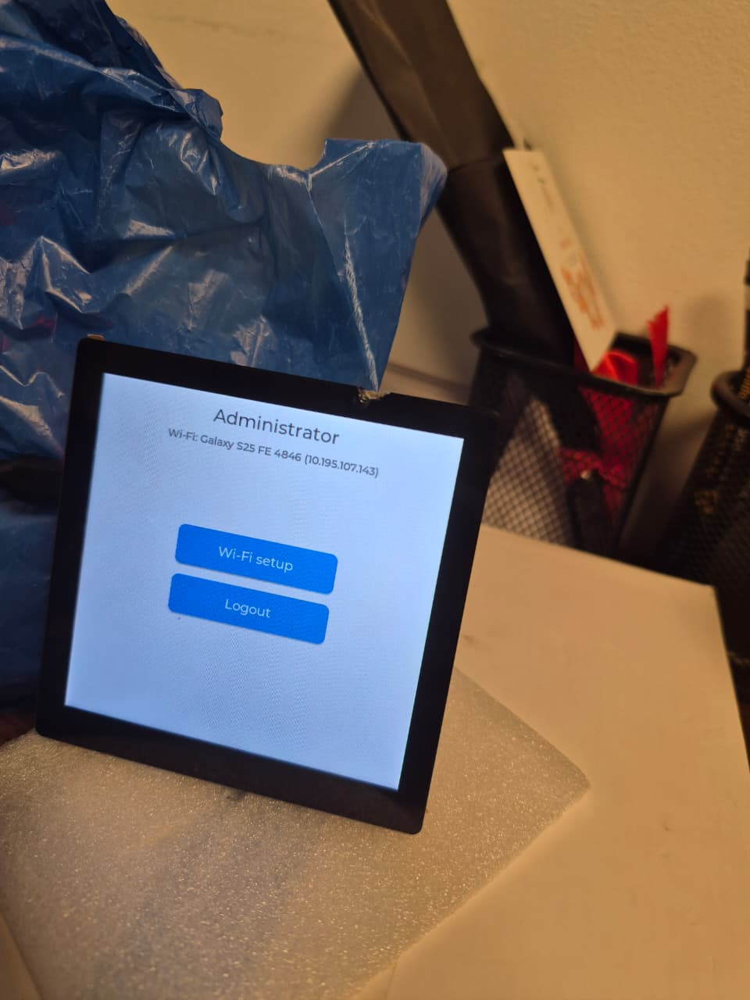<br><code>lcd4inch.jpg</code><br>our LCD board</td>
<td align="center" width="33%"><br><code>20260919103052.jpg</code><br>our handwritten note</td>
<td align="center" width="33%"><br><code>naruto.jpg</code><br>anime frame</td>
</tr>
<tr>
<td align="center"><br><code>labubu.jpg</code><br>cartoon illustration</td>
<td align="center">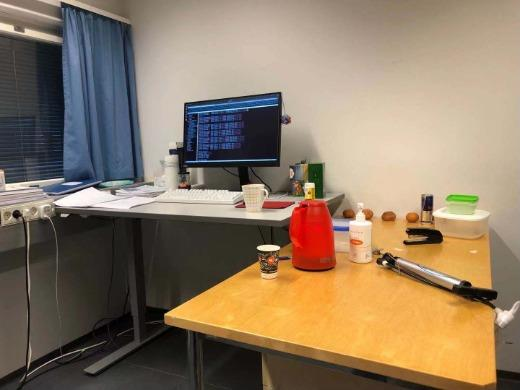<br><code>demo_office_desk.jpg</code><br>from the authors' README</td>
<td align="center">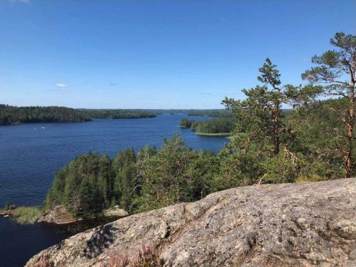<br><code>demo_lake.jpg</code><br>from the authors' README</td>
</tr>
</table>

The Labubu and Naruto images are used only as test inputs and belong to their respective owners. To use your own photos instead, put them in a new folder and pass that folder with `--datadir` (see the flags below).

**PiDiNet (complete model)**
```powershell
python main.py --model pidinet_converted --config carv4 --sa --dil -j 1 --gpu 0 --savedir results/pretrained_full --datadir custom_images --dataset Custom --evaluate trained_models/table5_pidinet.pth --evaluate-converted
```

**Baseline (vanilla convolutions)**
```powershell
python main.py --model pidinet --config baseline --sa --dil -j 1 --gpu 0 --savedir results/pretrained_baseline --datadir custom_images --dataset Custom --evaluate trained_models/table5_baseline.pth
```

**PiDiNet-Small and PiDiNet-Tiny**
```powershell
python main.py --model pidinet_small_converted --config carv4 --sa --dil -j 1 --gpu 0 --savedir results/pretrained_small --datadir custom_images --dataset Custom --evaluate trained_models/table5_pidinet-small.pth --evaluate-converted
python main.py --model pidinet_tiny_converted --config carv4 --sa --dil -j 1 --gpu 0 --savedir results/pretrained_tiny --datadir custom_images --dataset Custom --evaluate trained_models/table5_pidinet-tiny.pth --evaluate-converted
```

The edge maps are saved in `results/pretrained_<name>/eval_results/imgs_epoch_019/` (PNG images; the raw probabilities are in `mats_epoch_019/`). Each run takes about 15 seconds.

What the flags mean:

* `--model pidinet_converted ... --evaluate-converted` folds the pixel-difference convolutions into ordinary convolutions after loading the weights. The output is the same, and inference is faster. The Baseline already uses ordinary convolutions, so it needs no conversion.
* `--config carv4` is the paper's mix of pixel-difference layers; `--config baseline` is all ordinary convolutions.
* `--sa --dil` switch on the CSAM and CDCM modules.
* `--datadir` must be a folder that contains **only images**. To use your own photos, put them in a new folder and pass that folder.

The other checkpoints in `trained_models/` (the `-l` variants, `table6`, `table7`) use different flags. See `scripts.sh`.

## Part 2 – Train the Baseline and the complete PiDiNet

Do the [Dataset](#dataset) step first. We trained both models for 3 epochs on the 28,800 pairs, with identical settings except `--config`.

**Train the Baseline**
```powershell
python main.py --model pidinet --config baseline --sa --dil --only-bsds -j 2 --gpu 0 --epochs 3 --iter-size 24 --lr 0.005 --lr-type multistep --lr-steps 1-2 --wd 1e-4 --savedir results/my_baseline --datadir data/HED-BSDS --dataset BSDS
```

**Train the complete PiDiNet**
```powershell
python main.py --model pidinet --config carv4 --sa --dil --only-bsds -j 2 --gpu 0 --epochs 3 --iter-size 24 --lr 0.005 --lr-type multistep --lr-steps 1-2 --wd 1e-4 --savedir results/my_pidinet --datadir data/HED-BSDS --dataset BSDS
```

Notes:

* **Pick a new `--savedir`.** The folders `results/train_baseline_real` and `results/train_pidinet_real` already hold our final checkpoints (`checkpoint_002.pth`), and the notebook uses them. Training into those folders would overwrite them.
* `--iter-size 24` means one image is processed per step and the weights are updated every 24 images (an effective batch of 24), so one epoch is 1,200 updates.
* `--lr-steps 1-2` divides the learning rate by 10 at epochs 1 and 2 (0.005, then 0.0005, then 0.00005).
* `--only-bsds` is needed because we did not use the PASCAL VOC data.
* Time on an RTX 4050 laptop GPU (6 GB): about 80 minutes for the Baseline and about 90 minutes for the complete PiDiNet. Progress is printed every 10 updates, one line per epoch goes to `<savedir>/pidinet_log.txt`, and a checkpoint is saved after every epoch in `<savedir>/save_models/`.
* Results vary a little between runs because the default seed changes. Add `--seed 1` to fix it.

For reference, our average training loss per epoch (your numbers should be close):

| Epoch | Baseline | Complete PiDiNet |
|---|---|---|
| 1 | 9,509 | 9,342 |
| 2 | 7,828 | 8,048 |
| 3 | 7,522 | 7,837 |

**Generate edge maps on the 200 test images** (the last checkpoint is `checkpoint_002.pth`)
```powershell
python main.py --model pidinet --config baseline --sa --dil -j 2 --gpu 0 --only-bsds --savedir results/eval_my_baseline --datadir data/HED-BSDS --dataset BSDS --evaluate results/my_baseline/save_models/checkpoint_002.pth
python main.py --model pidinet_converted --config carv4 --sa --dil -j 2 --gpu 0 --only-bsds --savedir results/eval_my_pidinet --datadir data/HED-BSDS --dataset BSDS --evaluate results/my_pidinet/save_models/checkpoint_002.pth --evaluate-converted
```

**Score them (ODS / OIS)** with the Python evaluator, which needs the BSDS500 ground truth from the Dataset step:
```powershell
python eval_ods_ois.py results/eval_my_baseline/eval_results/mats_epoch_002 data/BSDS500_raw/BSR/BSDS500/data/groundTruth/test --n-thresholds 25
python eval_ods_ois.py results/eval_my_pidinet/eval_results/mats_epoch_002 data/BSDS500_raw/BSR/BSDS500/data/groundTruth/test --n-thresholds 25
```

Each scoring run takes about a minute. Our results:

| Model | ODS | OIS |
|---|---|---|
| Baseline, 3 epochs (ours) | 0.777 | 0.788 |
| Complete PiDiNet, 3 epochs (ours) | 0.781 | 0.790 |
| Baseline, paper's pretrained (official numbers: 0.798 / 0.816) | 0.792 | 0.802 |
| Complete PiDiNet, paper's pretrained (official numbers: 0.807 / 0.823) | 0.798 | 0.809 |

`eval_ods_ois.py` matches edges by nearest-neighbour distance, not the official one-to-one matching, so its numbers are an approximation. As the last two rows show, it reads about 0.006 to 0.009 ODS below the official figures. You can check that yourself by scoring a pretrained checkpoint the same way (use `--evaluate trained_models/table5_pidinet.pth` and `--savedir results/eval_paper_pidinet`, and note the folder is then `mats_epoch_019`).

## Part 3 – Run the comparison notebook

`notebook/compare_edges.ipynb` runs one image through 11 methods and plots them side by side:

* Classical: Sobel, Roberts, Canny
* HED (the 2015 deep edge detector), run on the GPU
* The paper's four pretrained models (Baseline, Tiny, Small, Full)
* Our two retrained models (Baseline, Full)

Nothing needs to be edited and no dataset is needed, but the first run needs an internet connection. To run it:

1. Complete [Setting up the environment](#setting-up-the-environment).
2. Open `notebook/compare_edges.ipynb` in VS Code (with the Python and Jupyter extensions). Click **Select Kernel** at the top right and choose the Python from this repository's `venv` folder. The notebook finds the `src/` folder next to it by itself, so open it from its own folder.
3. Click **Run All**.

For a browser instead of VS Code: `pip install notebook`, then `jupyter notebook` from the `notebook/` folder (not tested here).

What happens:

* The first run downloads the HED weights (about 59 MB) into `src/hed_weights/`. The notebook does this with `curl.exe`, which Windows 10 and 11 include. On another system, download these two files into `src/hed_weights/` yourself and the notebook will skip the download: `https://vcl.ucsd.edu/hed/hed_pretrained_bsds.caffemodel` and `https://raw.githubusercontent.com/s9xie/hed/master/examples/hed/deploy.prototxt`.
* It runs your chosen image, then all four sample photos, then the paper's own README photos (compared with the authors' published output; that part also downloads the README figure, about 0.2 MB, into `src/paper_demo/`, again with `curl.exe`). About 1.5 minutes of compute on an RTX 4050, plus the one-time download.
* Results are written to `src/results/notebook_compare/`: one comparison grid per image (`compare_<image>.png`) plus one PNG per method. These files are created on your machine and are not committed (see `.gitignore`).
* To try your own photo, change the path in section 6 (`IMAGE = ...`). Example outputs are shown in [Example results](#example-results).

The notebook is written to fall back to the CPU if no GPU is found, but that has not been tested. `compare_edges_executed.ipynb` is a finished run from the authors' machine (its stored paths point to that machine), so you can see the expected output without running anything.

## Example results

Every figure below is made by the notebook in Part 3. Each one runs a single photo through 11 methods: Sobel, Roberts and Canny (CPU), then HED, the paper's Baseline, Tiny, Small and Full, and our two retrained models (teal titles). The number under each name is the inference time; HED and the PiDiNet models ran on an RTX 4050. Click an image to see it full size.

### Our own photos

**LCD board.** Sobel and Roberts light up the foam speckle and Canny leaves stray dots on it. HED and PiDiNet keep the panel, the buttons and the pen holder.
<div align=center>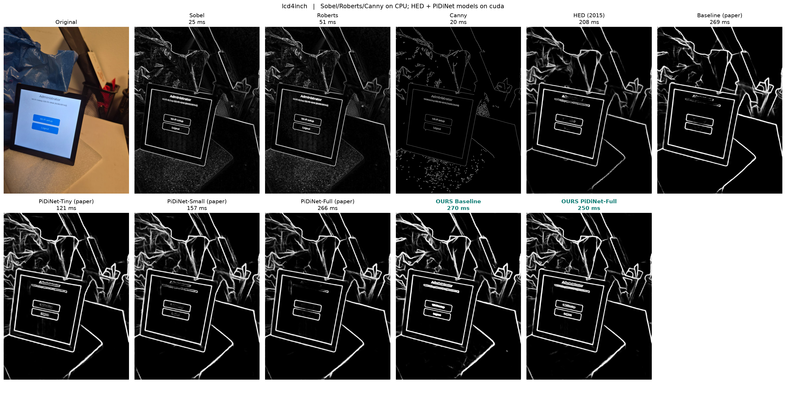</div>

**Handwritten note.** Canny breaks the faint handwriting into fragments; PiDiNet keeps both the spiral binding and the letters.
<div align=center>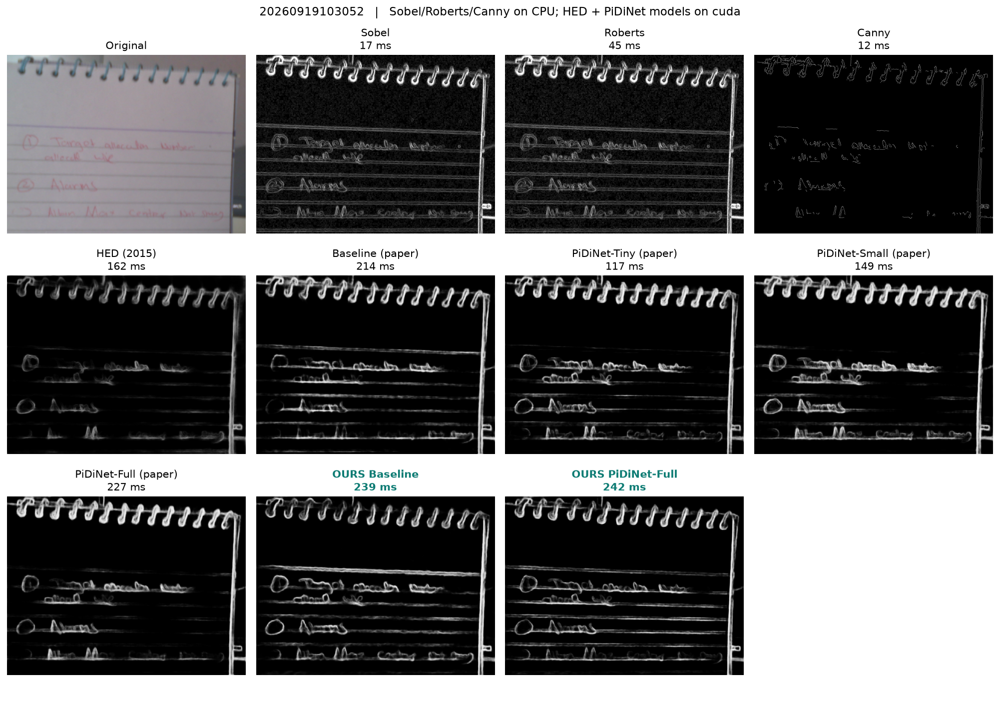</div>

**Cartoon (Labubu).** On clean line art the classical filters are competitive. The deep models give thicker, softer outlines, partly because the image is only 413 x 743 pixels.
<div align=center>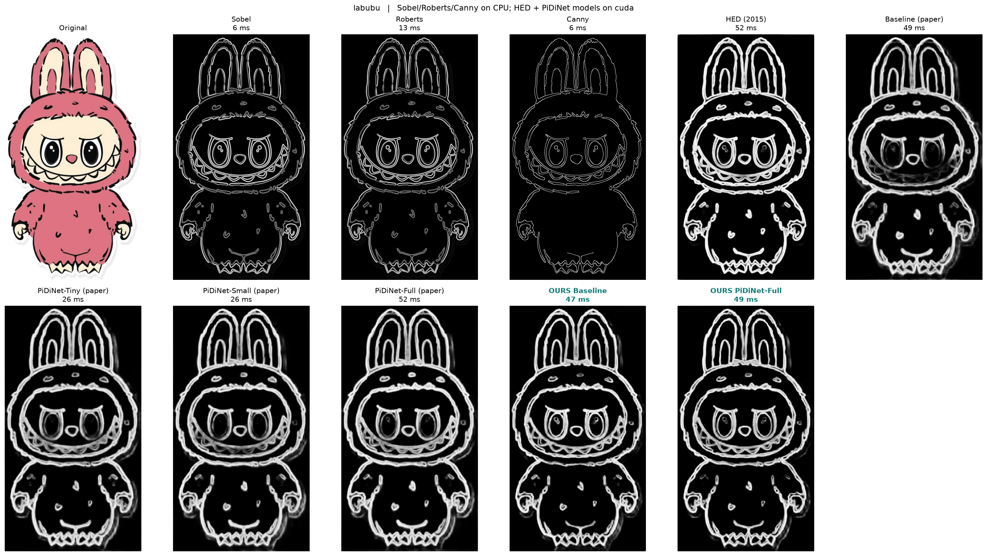</div>

**Anime frame (Naruto).** The classical filters are faint and sparse. HED has the calmest background, and PiDiNet draws the same subjects with more foliage texture.
<div align=center>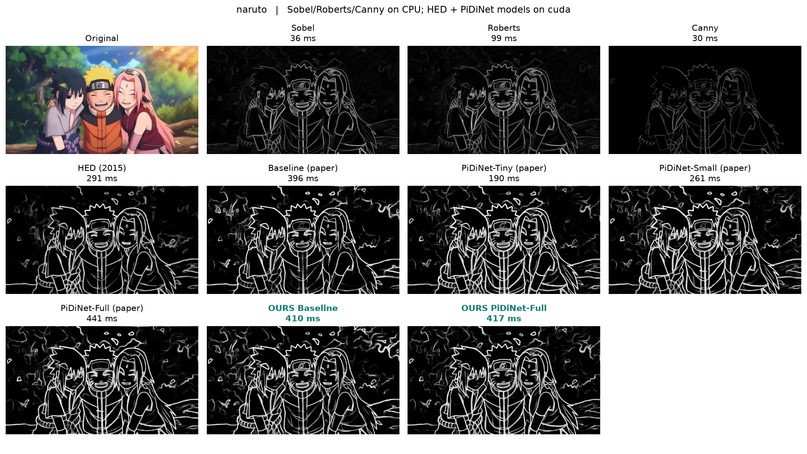</div>

### The paper's own photos

The last panel in each of these figures is the authors' published edge map. The README figure only contains about 520 x 390 pixel thumbnails, and the output depends on the input size. At native size our run of the paper's checkpoint gives thicker, softer edges than the authors' map (`x1`). Upscaling the same thumbnail 3 times (`x3`, plain bicubic, no new detail) gives maps that closely match theirs. This is consistent with the authors having run the original full-resolution photos.

**Office desk, native size (x1) and upscaled 3x (x3)**
<div align=center>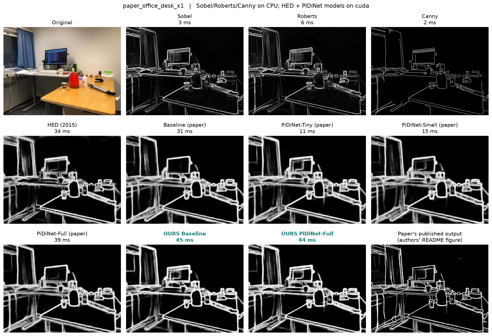</div>
<div align=center>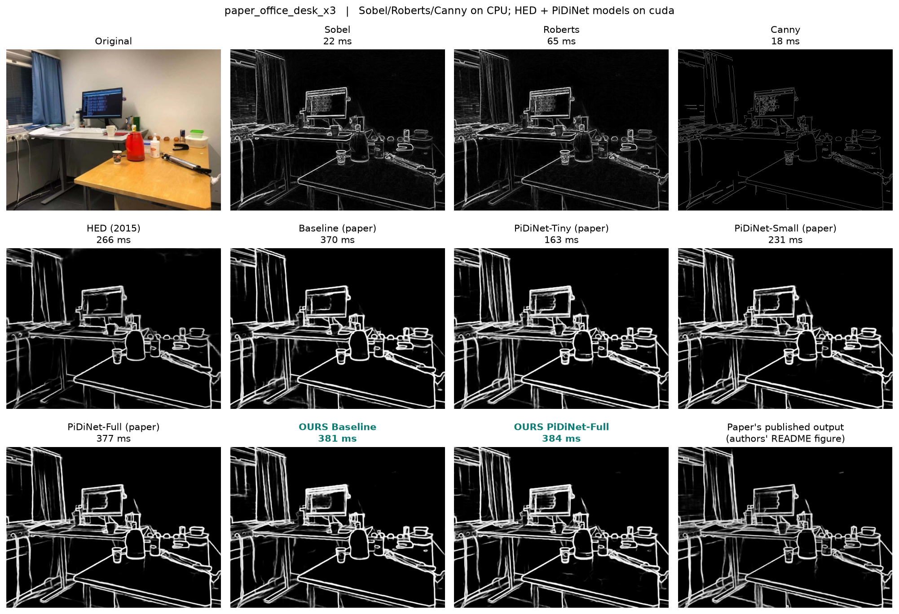</div>

**Lake, native size (x1) and upscaled 3x (x3)**
<div align=center>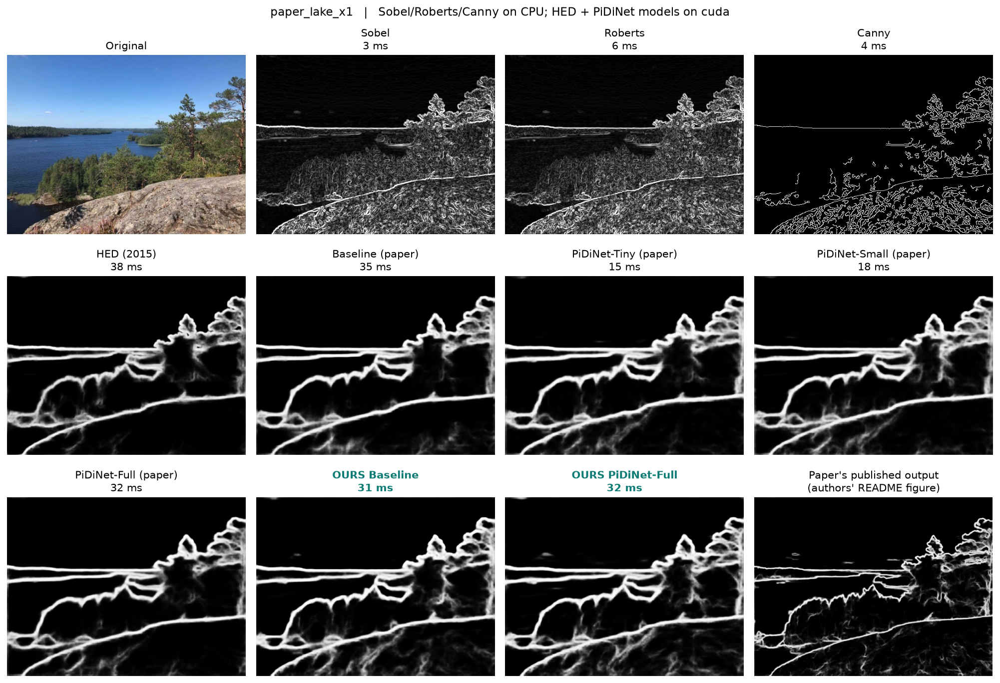</div>
<div align=center>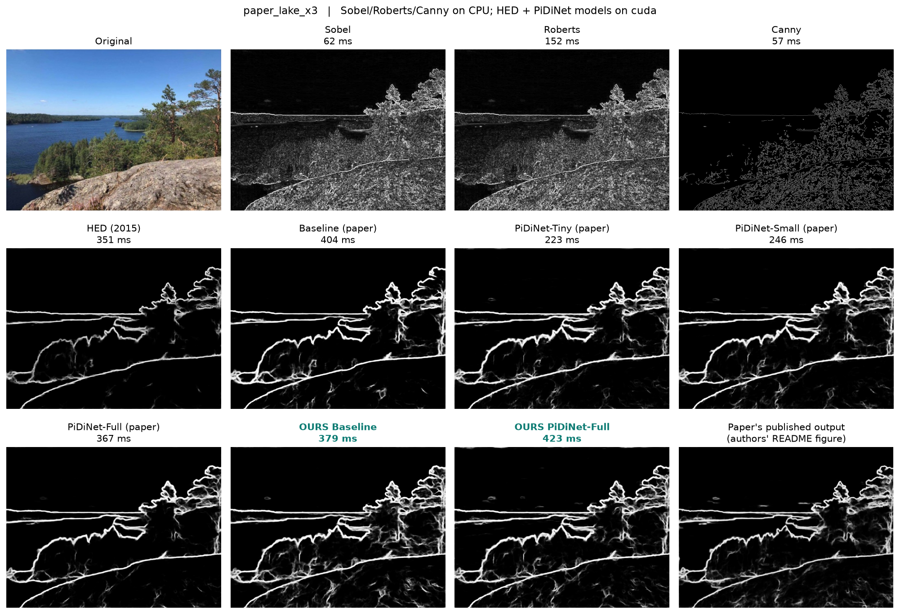</div>

## Generating edge maps for your own images
This is Part 1 with your own folder. For the complete PiDiNet:
```bash
python main.py --model pidinet_converted --config carv4 --sa --dil -j 1 --gpu 0 --savedir results/my_output --datadir /path/to/custom_images --dataset Custom --evaluate trained_models/table5_pidinet.pth --evaluate-converted
```

To compare your photo against all 11 methods at once, as in the figure below, use the notebook in [Part 3](#part-3--run-the-comparison-notebook) and change `IMAGE` in section 6.

<div align=center>
<br>
One of our own photos (an anime frame) run through the 11 methods by the notebook: Sobel, Roberts and Canny on the CPU, then HED, the paper's Baseline, Tiny, Small and Full, and our two retrained models (teal titles). The number under each name is the inference time; HED and the PiDiNet models ran on an RTX 4050.
</div>

The authors' own example, from their README:

<div align=center>
<br>
The results of our model look like this.
</div>

## Troubleshooting

| Problem | Fix |
|---|---|
| `Activate.ps1 cannot be loaded because running scripts is disabled` | Run `Set-ExecutionPolicy -Scope CurrentUser -ExecutionPolicy RemoteSigned`, then activate again. |
| `torch.cuda.is_available()` prints `False` | A CPU-only torch was installed. torch and torchvision must come from the CUDA index. Run `pip uninstall -y torch torchvision`, then `pip install -r requirements.txt` again. Installing torchvision alone from PyPI silently replaces a CUDA torch with the CPU build. |
| `No space left on device` during `pip install` | pip unpacks torch (about 2.5 GB) in your temp folder. Point it at a drive with space first: `$env:TMP="D:\pip_tmp"; $env:TEMP="D:\pip_tmp"; $env:PIP_CACHE_DIR="D:\pip_cache"`. |
| Download fails with `CRYPT_E_REVOCATION_OFFLINE` or an SSL error | Add `--ssl-no-revoke` to the `curl.exe` command. |
| `module 'cv2.dnn' has no attribute 'readNetFromCaffe'` | OpenCV 5.x was installed. Use the 4.x version in `requirements.txt` (`opencv-python==4.14.0.94`). |
| `Assertion target_val >= zero && target_val <= one failed` during training | You are using the authors' original `utils.py` with a recent PyTorch. The `utils.py` in this repository already contains the fix: the loss gives ambiguous pixels weight 0, but PyTorch also rejects a target value of 2, so those targets are set to 0 (`target[label == 2] = 0`). |
| `Custom` run stops with an image-reading error | `--datadir` must contain only image files (the loader opens every file in the folder). |

## Credits and licence

* Code: the authors' repository, https://github.com/hellozhuo/pidinet (MIT licence, see `LICENSE`). This repository adds `eval_ods_ois.py`, the notebook, the loss fix in `utils.py`, and the training and evaluation steps above.
* BSDS500: Arbeláez, Maire, Fowlkes and Malik, "Contour Detection and Hierarchical Image Segmentation", IEEE TPAMI 2011.
* HED data and weights: Xie and Tu, "Holistically-Nested Edge Detection", ICCV 2015 (`vcl.ucsd.edu/hed`).
